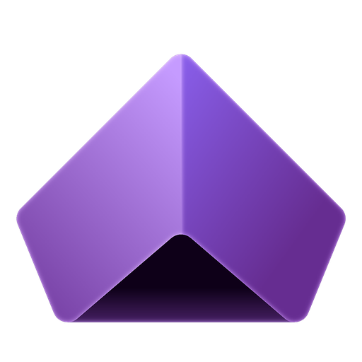

# Toca

**Chat, chamadas de voz, câmera e compartilhamento de tela com seus amigos — sem servidor e sem VPN.**

### ⬇️ [Baixar o Toca para Windows](https://github.com/Ticuliro1/toca/releases/latest)

Baixe o arquivo **Toca-Setup-x.x.x.exe** e instale. O Toca se atualiza sozinho depois.

> Na primeira vez o Windows pode mostrar *"O Windows protegeu o computador"* (o app ainda não tem
> assinatura digital paga). Clique em **Mais informações → Executar assim mesmo**.

## O que tem

- 📸 **Social:** poste fotos e vídeos com legenda, siga pessoas, curta, comente e compartilhe — com feed "Para você", vídeos em tela cheia, Em alta e Explorar
- 💬 Mensagens diretas com imagens, arquivos de até 1 GB, respostas, edição e emojis
- 👥 Grupos com modelos prontos, canais de texto e de voz, canais só para admins, modo lento, limite nas salas, administradores e convites
- 🎙️ Chamadas de voz com detecção de voz, pressionar para falar, supressão de ruído e volume por pessoa
- 📷 Câmera nas chamadas
- 🖥️ Compartilhamento de tela até 1440p/60 FPS, com qualidade ajustável ao vivo e áudio do PC (sem o som da chamada)
- 🌐 Conecta pela internet com um **código Toca** — não precisa de Radmin nem de VPN
- 🎉 Eventos e avisos ao vivo dentro do app
- 🔄 Atualizações automáticas

## Como usar com os amigos

1. Todo mundo instala o Toca e cria uma conta (fica salva no seu PC — sem e-mail).
2. Em **Amigos → Adicionar amigo**, copie o seu código (`TOCA@…`) e mande para o amigo, ou cole o código dele.
3. Crie um grupo no **+** à esquerda e convide seus amigos.

## Privacidade

O Toca não tem servidor central e não coleta dados. Mensagens, amigos e grupos ficam no seu computador.
Para se encontrarem pela internet, os Tocas usam relays públicos da rede Nostr apenas como "caixa de correio",
com mensagens assinadas e criptografadas de ponta a ponta. As chamadas e arquivos vão direto entre os PCs.
Como em qualquer conexão direta, amigos conectados podem ver seu IP público.

Tudo que você posta no **Social** é público para quem usa o Toca. Fotos e textos ficam em relays públicos da rede Nostr;
vídeos ficam no seu PC e vão direto para quem assiste (que pode ver seu IP). Posts podem ser denunciados, e o criador
do Toca pode remover posts e banir contas do Social.

## Termos

O Toca é gratuito e fornecido "como está", sem garantias. Você é responsável pelo que envia e compartilha.
Não use o Toca para atividades ilegais, assédio ou para compartilhar conteúdo de terceiros sem permissão.

Baixe o Toca só por esta página oficial.
